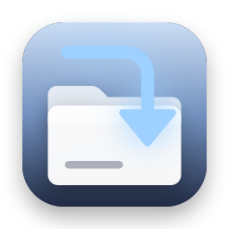
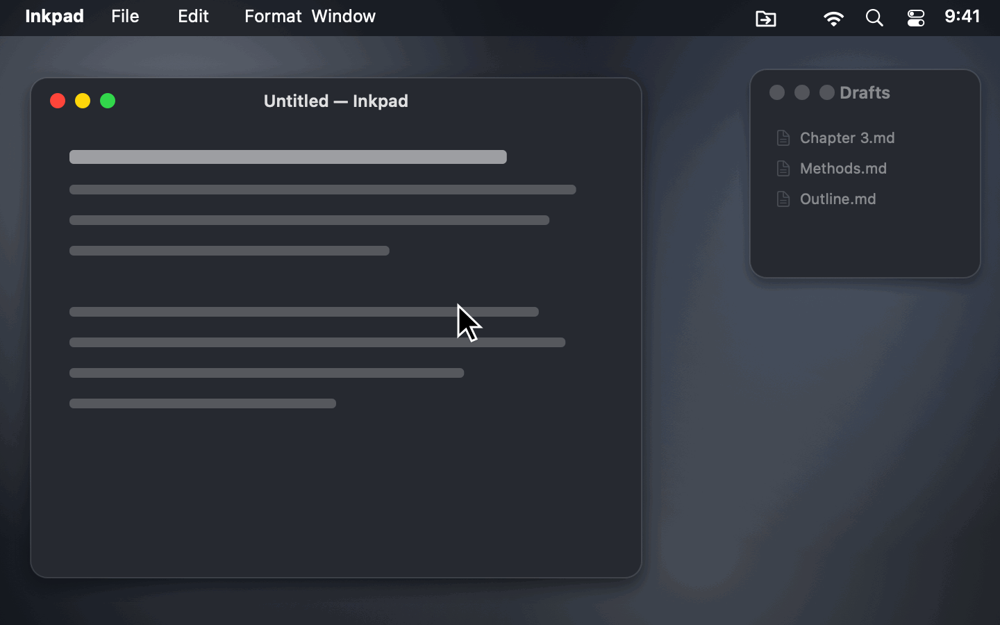
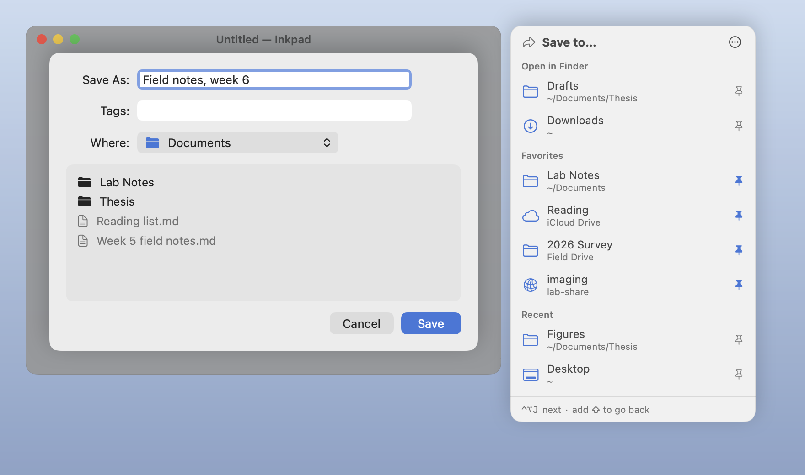
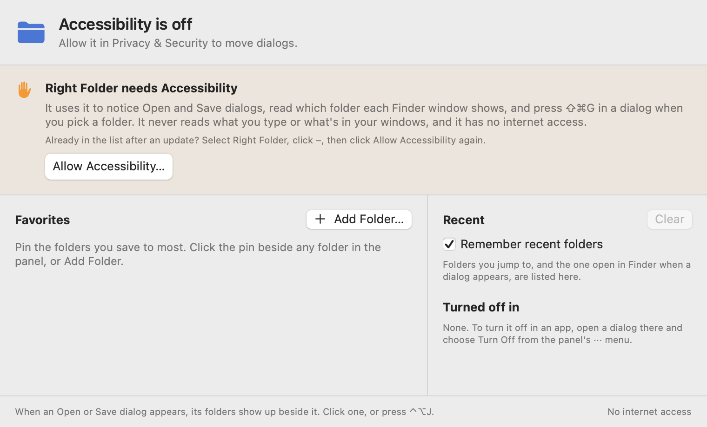

<p align="center">
  
</p>

<h1 align="center">Right Folder</h1>

<p align="center">
  <b>Open and Save dialogs, in the right folder.</b><br>
  A free, open-source menu bar app that puts the folders open in Finder, your recent folders and your favorites beside every Open and Save dialog. One click, or ⌃⌥J, and the dialog goes there. A free alternative to the core of Default Folder X.
</p>

<p align="center">
  <a href="https://github.com/stanczykwyatt/right-folder/releases/latest/download/Right-Folder.zip"><b>Download for Mac</b></a>
  &nbsp;·&nbsp;
  <a href="https://stanczykwyatt.github.io/right-folder/">Website</a>
  &nbsp;·&nbsp;
  <a href="https://github.com/users/stanczykwyatt/projects/1">Roadmap</a>
  &nbsp;·&nbsp;
  <a href="https://github.com/stanczykwyatt/right-folder/discussions">Discussions</a>
</p>

<p align="center">
  <a href="https://github.com/stanczykwyatt/right-folder/actions/workflows/ci.yml"></a>
  <a href="https://github.com/stanczykwyatt/right-folder/releases/latest"></a>
  
  
  
  
  <a href="LICENSE"></a>
</p>

<p align="center">
  
</p>

---

You have the folder open in Finder right there, and the Save dialog still starts in Documents. So you click through the sidebar, or drag the folder's icon in, or press ⇧⌘G and type the path.

Right Folder fixes that. Whenever an app shows an Open or Save dialog, a small panel appears beside it with the folders open in Finder, the folders you've used lately and the ones you've pinned. Click one and the dialog goes there. Or press ⌃⌥J to step through them without leaving the keyboard.

It has no internet access, never reads your files or what you type, and is open source, so you can check exactly what it does.

If it saves you some clicking, [starring the repo](https://github.com/stanczykwyatt/right-folder/stargazers) helps other people find it.

<picture>
  <source media="(prefers-color-scheme: dark)" srcset="docs/screenshot-dark.png">
  
</picture>

## Features

- **Folders open in Finder,** front window first, beside every Open and Save dialog.
- **Favorites** you pin from the panel, the menu or a folder picker. They follow a folder if you rename or move it.
- **Recent folders:** ones you jumped to, and the one open in Finder when a dialog appeared. Turn it off and the list is cleared.
- **One click** sends the dialog there, the same way you'd do it with ⇧⌘G.
- **⌃⌥J steps through the folders,** and ⌃⌥⇧J goes back. The shortcut only exists while a dialog is open, so it never gets in the way.
- **Works in any app** that uses the standard macOS Open and Save dialogs, as sheets or windows.
- **iCloud Drive, external drives and network shares,** named the way Finder names them. A drive that isn't plugged in, or a server you're not connected to, shows as not connected instead of making the dialog wait.
- **Turn it off in any app** from the panel's ··· menu, or pause it everywhere from the menu bar.
- **Private and offline.** Free, with no account, subscription, tracking or dependencies.

## Install

1. [Download **Right-Folder.zip**](https://github.com/stanczykwyatt/right-folder/releases/latest/download/Right-Folder.zip) and unzip it.
2. Move **Right Folder** to your Applications folder and open it. It opens at login from then on; turn that off in its menu.
3. Click **Allow Accessibility…** and switch on Right Folder in **System Settings → Privacy & Security → Accessibility**.
4. Open or save something in any app. The panel shows up beside the dialog.



> **Why Accessibility?** It's how Right Folder notices an Open or Save dialog, reads which folder each Finder window shows, and presses ⇧⌘G in the dialog when you pick a folder. Those are the only things it does with it. It never reads what you type, your windows' titles or text, or what's in a folder. [SECURITY.md](SECURITY.md) has the details.

> **About the security warning:** The first time you open Right Folder, macOS may say Apple couldn't verify that it's free of malware. It shows up because the app isn't notarized yet: Apple charges developers $99 a year for that, and this project hasn't paid the fee. The code is fully open source, so you can read every line or build the app yourself. To open it, go to **System Settings → Privacy & Security** and click **Open Anyway**.

> **After an update:** allow Accessibility again for the new version. In **System Settings → Privacy & Security → Accessibility**, select Right Folder, click **–**, then open Right Folder and click **Allow Accessibility…**. macOS ties the permission to each exact build, which keeps any other program from borrowing it.

> **Can't see the icon?** On a MacBook with a camera notch, menu bar icons that don't fit are hidden behind it. Hold ⌘ and drag the icon to the right, or quit a menu bar app you don't need.

### Build from source

You need macOS 14 or later and Swift 6, which comes with Xcode 16 or the Command Line Tools.

```bash
git clone https://github.com/stanczykwyatt/right-folder.git
cd right-folder
scripts/build-app.sh
open "build/Right Folder.app"
```

## How to use it

| To | Do this |
|---|---|
| Send a dialog to a folder | Click the folder in the panel beside it |
| Step through the folders | ⌃⌥J, or ⌃⌥⇧J to go back |
| Pin a folder | Click the pin beside it in the panel, or Menu → Pin a Folder… |
| Pin the folder open in Finder | Menu → Pin “…” from Finder |
| Reorder or remove favorites | Menu → Open Right Folder… |
| Turn it off in one app | Panel → ··· → Turn Off in that app |
| Pause it everywhere | Menu → Show Folders Beside Dialogs |
| Stop remembering recent folders | Menu → Remember Recent Folders, which clears the list too |
| Stop it opening at login | Menu → turn off Open at Login |

The panel lists up to eight folders open in Finder, your favorites, and eight recent folders. Each folder shows once. A favorite stays with your favorites even while it's open in Finder, with a small window mark beside it.

## Privacy and security

Right Folder is built so it *can't* misuse what it sees, not just so it promises not to.

- **Folder paths only.** It knows the names of folders: the one each Finder window shows, your favorites and your recent ones. It checks a folder exists without looking inside it, and never opens a file.
- **Never reads what you type.** It has no keyboard monitor. The ⌃⌥J shortcut is registered with macOS only while a dialog is open, and macOS tells it only that the shortcut was pressed.
- **Doesn't read your windows.** From the app showing a dialog it reads only which window is in front and whether it's an Open or Save dialog, from the window's role and identifier. Never its title or text. The one field it reads is the Go to Folder field it just filled in.
- **Keys go only where they're meant to.** When you pick a folder, it sends ⇧⌘G, the folder's path and Return to the app showing the dialog and no other, and only after checking that dialog is still in front. Return is only sent to the Go to Folder field it opened inside that dialog. If it can't be sure that's where the keyboard is, it stops, so it won't click Save for you.
- **No internet access.** It never connects to anything. CI checks the source and the built app of every build for that, and for everything above.
- **No entitlements and no dependencies.** Every line that runs is in this repository.

Check the app's permissions yourself with `codesign -d --entitlements - "/Applications/Right Folder.app"`, which prints none. The full details are in [SECURITY.md](SECURITY.md).

## FAQ

**Is this a free alternative to Default Folder X?**
For its core, yes: folders open in Finder, recent folders and favorites, one click away in every Open and Save dialog. Default Folder X does a lot more, like previews, tagging and file info in the dialog. Right Folder does the jumping, for free, with its source open.

**How do I make a Save dialog open in the folder I have open in Finder?**
With Right Folder running, the folder is listed first in the panel beside the dialog. Click it, or press ⌃⌥J.

**Can I get to a folder in an Open or Save dialog with the keyboard?**
macOS has ⇧⌘G, which asks you to type the path. Right Folder does that for you: ⌃⌥J goes to the first folder in its list, and pressing it again goes to the next.

**Does it work in every app?**
It works in apps that use the standard macOS Open and Save dialogs, which is nearly all of them, whether the dialog is a sheet or its own window. Apps with their own file browser, like some Java apps, aren't recognized. If a dialog in an app you use doesn't get the panel, please [say which app](https://github.com/stanczykwyatt/right-folder/issues/new?template=bug.yml).

**Why does it need Accessibility?**
To see that an Open or Save dialog appeared, to read which folder each Finder window shows, and to press ⇧⌘G in the dialog for you. It doesn't use Automation, Full Disk Access, Input Monitoring or Screen Recording.

**Does it slow anything down?**
No. It listens for windows opening and focus moving in the app in front, and only looks closer when that happens. While a dialog is open, it checks once a second that it hasn't moved. An app that's busy is left alone for a few seconds.

**Does it work on Intel Macs?**
Yes. The download runs on Apple silicon and Intel Macs with macOS 14 Sonoma or later.

## More free Mac utilities

- **[Show Desktop](https://github.com/stanczykwyatt/show-desktop):** hide every window with one click or ⌃⇧D, then bring them all back exactly as they were.
- **[Copy 2FA](https://github.com/stanczykwyatt/copy-2fa):** copy 2FA codes from Mail, Messages or a built-in authenticator with one keyboard shortcut.
- **[Who Stole My Focus](https://github.com/stanczykwyatt/who-stole-my-focus):** find out which app keeps jumping in front of your work.
- **[AI Footprint](https://github.com/stanczykwyatt/ai-footprint):** see what AI coding tools leave on your Mac, and what each update changed.
- **[Memo Export](https://github.com/stanczykwyatt/memo-export):** export your Voice Memos transcripts as Markdown, with the audio.
- **[Podcast Export](https://github.com/stanczykwyatt/podcast-export):** export your Apple Podcasts shows as OPML, and your listening history.
- **[Reading List Export](https://github.com/stanczykwyatt/reading-list-export):** export your Safari Reading List as Markdown, bookmarks and CSV.
- **[Unblock Eject](https://github.com/stanczykwyatt/unblock-eject):** see what's keeping your disk from ejecting, and quit it politely.
- **[Next Departures](https://github.com/stanczykwyatt/next-departures):** your stop's next bus and train, live, in the menu bar.

All but Next Departures have no internet access, and it connects only to the transit feeds you use.

## Contributing

Contributions are welcome, especially reports of apps whose dialogs it misses or can't move. See [CONTRIBUTING.md](CONTRIBUTING.md), and the [roadmap](https://github.com/users/stanczykwyatt/projects/1) for what's planned. Ideas go in [Discussions](https://github.com/stanczykwyatt/right-folder/discussions).

## License

Right Folder is released under the [MIT License](LICENSE) and is provided as is, without warranty of any kind.

Right Folder is an independent project. It isn't affiliated with, endorsed by or sponsored by Apple Inc. or St. Clair Software. Default Folder X is a trademark of St. Clair Software, named here only to say what Right Folder is an alternative to; Right Folder shares no code or design with it. Apple, Mac, macOS, Finder and iCloud are trademarks of Apple Inc., registered in the U.S. and other countries. Other product names belong to their owners. The app, folders and files in the screenshots and demo are made up.
